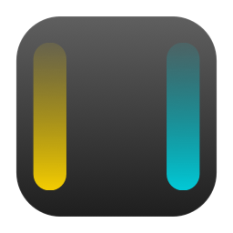

# EdgeDial

Control screen brightness and volume from the edges of your MacBook trackpad.

Rest a finger on the **left** edge for a moment, then slide up and down to change
**brightness**. Same on the **right** edge for **volume**. Lift your finger and
you're done.



```
┌─────────────────────────────┐
│ BRIGHT  │           │  VOL   │
│  ███    │           │  ███   │
│  ███    │  normal   │  ███   │   1. rest a finger on an edge
│  ███    │           │  ███   │   2. wait ~300ms → indicator appears
└─────────────────────────────┘   3. slide ↕, then lift
```

No Accessibility permission, no Input Monitoring permission, no prompts at all.
Normal clicking, scrolling and swiping are untouched — EdgeDial only reads.

## Why resting instead of clicking

The obvious design is "click the edge, then slide". It doesn't work well: a
physical trackpad click is delivered to whatever app is focused, so arming a
dial with a click means swallowing that click — and then clicking the left or
right part of your trackpad stops working everywhere. Intercepting and
re-posting clicks to work around that breaks drags and text selection in subtle
ways.

Resting a finger costs nothing, because no click is involved at all.

The tradeoff is false positives, so the gesture is deliberately fussy:

- The finger must **land** inside the edge strip. A cursor swipe that happens to
  end near the edge can't arm a dial.
- It must stay inside a small jitter radius for the whole dwell. Any drift and
  the touch is disqualified.
- A disqualified touch cannot re-arm until **every** finger has left the
  trackpad.
- Extra fingers cancel, so two-finger scrolling near an edge is safe.

While a dial is live, the pointer is pinned in place so your slide doesn't drag
the cursor across the screen.

## Install

Requires macOS 13 or later and Xcode command line tools.

```bash
git clone https://github.com/DiegoHermosilloP/EdgeDial.git
cd EdgeDial
./Scripts/build-app.sh --install
open /Applications/EdgeDial.app
```

EdgeDial lives in the menu bar (the sliders icon). Turn on **Launch at Login**
from its menu to have it start with your Mac.

## Settings

Most things are in the menu bar:

| Item | What it does |
| --- | --- |
| **Enabled** | Master switch |
| **Left Edge** / **Right Edge** | Brightness, Volume, or Nothing |
| **Hold Delay** | How long a finger must rest before a dial arms, 150–700 ms |
| **Slide Up Decreases** | Flips the direction |
| **Show Indicator** | EdgeDial's own on-screen level bar |
| **Haptic Feedback** | Tick when a dial arms and at the ends of the range |
| **Volume Sound** | The system volume tick as the volume dial crosses each step |
| **Hold Pointer Still** | Pin the cursor during a slide |
| **Launch at Login** | Start with macOS |

Everything else lives in
`~/Library/Application Support/EdgeDial/config.json`, reachable via
**Edit Settings File…** and picked up by **Reload Settings**:

| Key | Default | Meaning |
| --- | --- | --- |
| `leftZoneWidth` / `rightZoneWidth` | `0.18` | Edge strip width, as a fraction of trackpad width |
| `dwellJitter` | `0.035` | How far the finger may drift during the dwell before being disqualified |
| `sensitivity` | `1.5` | Range covered by sliding the full height of the trackpad |
| `requiredFingerCount` | `1` | Fingers the gesture needs; `2` makes accidental arming nearly impossible |
| `minimumTouchSize` | `0.08` | Rejects stray brushes |
| `hudSegments` | `0` | `0` draws a continuous bar; a positive number splits it into that many segments |
| `volumeFeedbackSound` | `true` | Also available in the menu |

**Edit Settings File…** opens the file in TextEdit specifically, rather than
handing a `.json` to whatever happens to claim that extension — which is Xcode
on a developer's Mac, but could as easily be Excel, Chrome or Notes, and on a
Mac with no handler registered gives an error instead of a file. TextEdit ships
with every macOS install. Option-click the same row for **Reveal Settings in
Finder** if you'd rather use your own editor.

If a dial arms when you didn't mean it, raise **Hold Delay** or lower
`leftZoneWidth`. If it's hard to trigger, do the opposite.

## The volume tick

The volume keys play a short sound as you hold them down, so you can judge the
new level by ear without looking. EdgeDial does the same: one tick each time a
slide crosses one of the sixteen steps macOS divides the volume into.

It plays through `NSSound` rather than `AudioServicesPlaySystemSound`,
deliberately — `NSSound` goes out through the default output device, so the
tick is heard *at* the level just set, which is the whole point of it. The clip
is the system's own (`Media Keys.aif`), read from disk by reference rather than
bundled, so it always matches whatever the current macOS ships.

It respects **System Settings → Sound → Play feedback when volume is changed**.
With that off, EdgeDial stays silent too and its menu item says so instead of
showing a checkmark that does nothing.

## How it works

| Concern | Mechanism | Permission |
| --- | --- | --- |
| Raw finger positions | `MultitouchSupport.framework` | none |
| Brightness | `DisplayServices.framework` | none |
| Volume | CoreAudio (`kAudioDevicePropertyVolumeScalar`) | none |
| Holding the pointer still | `CGAssociateMouseAndMouseCursorPosition` | none |

The pointer lock is why EdgeDial needs no permissions. The alternative —
swallowing pointer-movement events with a `CGEventTap` — would require
Accessibility access, and detaching the pointer achieves the same thing with a
plain CoreGraphics call.

`MultitouchSupport` and `DisplayServices` are private frameworks, so they are
loaded with `dlopen`/`dlsym` rather than linked. If a future macOS moves or
changes them, EdgeDial reports the problem in its menu instead of failing to
launch.

## Troubleshooting

```bash
.build/release/EdgeDial --probe
```

Prints whether the trackpad is readable, whether brightness and volume can be
driven, whether the volume tick sound was found, and ten seconds of live finger
coordinates. Useful after a macOS update.

## Surviving sleep

The trackpad stream does not always come back after the Mac sleeps — close the
lid a few times and the dials would go quiet while the app sat there apparently
fine. EdgeDial now checks the stream every two seconds and rebuilds the device
from scratch when it has died, rather than restarting the old handle, which
after a sleep can report success while delivering nothing.

Telling "dead" from "nobody is touching the trackpad" is the tricky part, since
silence is the normal state. The tell is silence *while the pointer is moving*:
on a laptop the pointer only moves because a finger is on the glass, so frames
must be arriving. Rebuilds also back off if they do not restore frames, so a
Mac driven by an external mouse does not rebuild forever.

## Limits

- Brightness applies to the built-in display. External monitors need DDC, which
  EdgeDial doesn't do.
- Private frameworks mean this can't ship on the App Store, and a future macOS
  could change them.
- Built and tested on a MacBook Air (M1) running macOS 26.3.

## Development

```bash
swift build          # build
swift test           # run the gesture state machine tests
./Scripts/build-app.sh   # bundle without installing
```

The gesture logic in `Sources/EdgeDial/GestureEngine.swift` is pure and has no
dependency on the trackpad, so `Tests/EdgeDialTests` drives it with synthetic
frames.

## License

MIT
